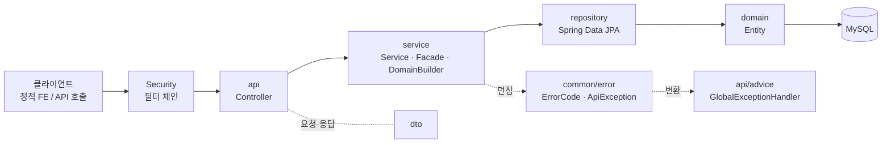
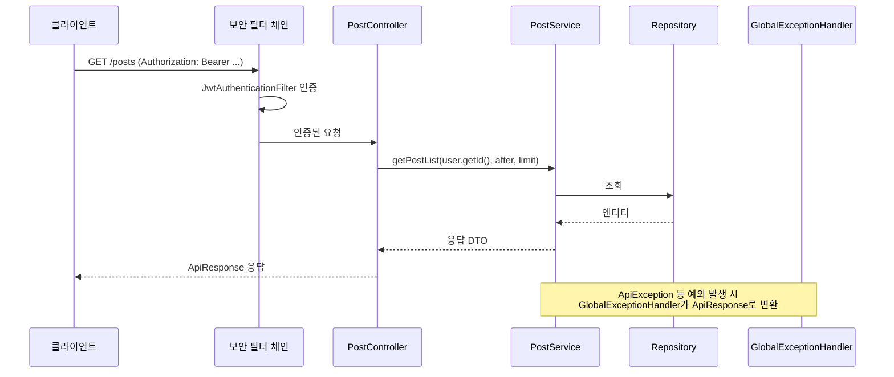
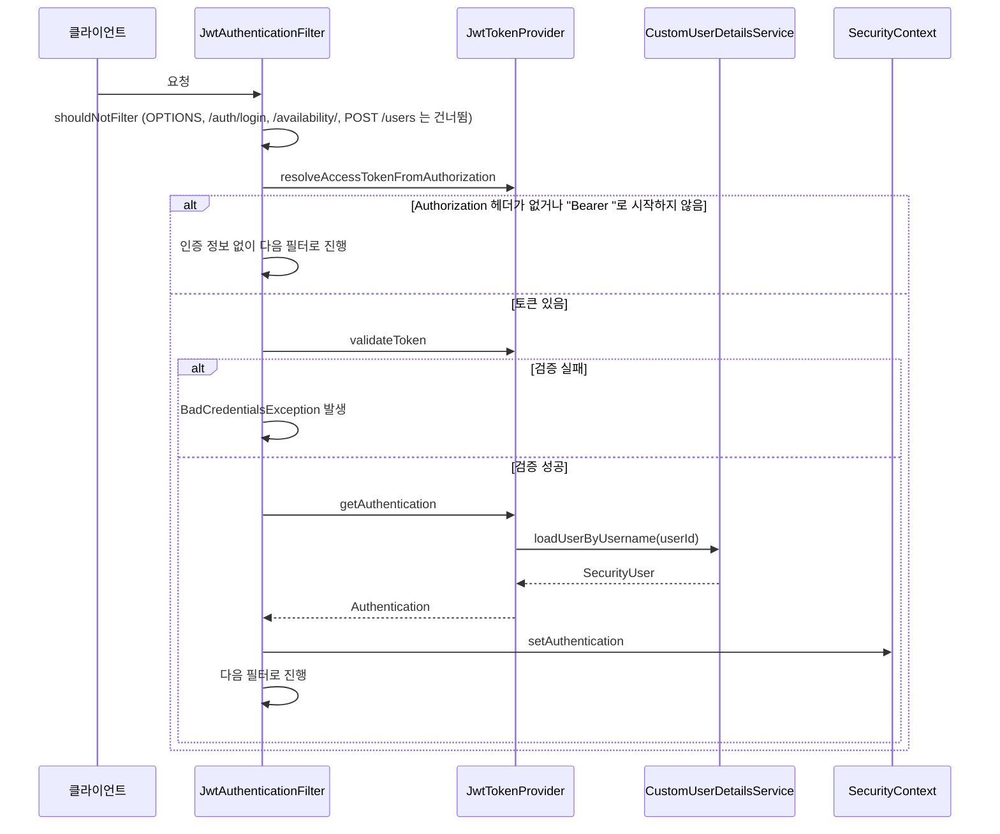
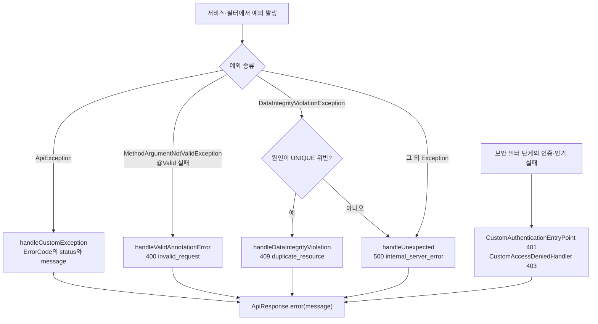

# 아키텍처

백엔드(`ktb3.fullstack.week4`)의 계층 구조, 요청 흐름, 보안 필터 체인, 예외 처리 흐름을 정리한다.
참조는 라인 번호 대신 `클래스#메서드`로 적는다.

## 1. 계층과 패키지 책임

| 패키지 | 책임 | 대표 클래스 |
|---|---|---|
| `api/{auth,availability,post,user}` | HTTP 매핑. 각 컨트롤러는 Swagger 명세용 `*Api` 인터페이스를 구현한다 | `PostController implements PostApi` |
| `api/advice` | 예외를 `ApiResponse` 응답으로 변환 | `GlobalExceptionHandler` |
| `service/*` | 비즈니스 로직, 트랜잭션 경계 | `UserService`, `PostService`, `AuthService`, `LikeService`, `CommentService` |
| `service/*` (Facade) | 여러 리포지토리에 걸친 삭제 처리 | `UserDeleteFacade`, `PostDeleteFacade` |
| `service/*` (DomainBuilder) | 엔티티 생성 | `UserDomainBuilder`, `PostDomainBuilder`, `CommentDomainBuilder`, `LikeDomainBuilder`, `ImageDomainBuilder` |
| `service/errors` | 존재 확인과 예외 발생 | `ErrorCheckServiceImpl` |
| `service/images` | 이미지 경로 생성·파일 저장 | `ProfileImageService`, `PostImageService` |
| `repository/*` | `JpaRepository` 기반 데이터 접근 | `PostRepository`, `UserRepository` 등 |
| `domain/*` | JPA 엔티티, 공통 부모 | `User`, `Post`, `BaseTimeEntity`, `SoftDeletetionEntity` |
| `dto/*` | 요청·응답 객체, 공통 응답 래퍼 | `ApiResponse<T>` |
| `Security/*` | JWT 인증 필터, 보안 설정, 인증 사용자 | `SecurityConfig`, `JwtAuthenticationFilter`, `JwtTokenProvider`, `SecurityUser` |
| `common/error/*` | 에러 코드 enum, 도메인 예외 | `ErrorCode`, `ApiException` |
| `config`, `config/swagger` | MVC·Jackson·Swagger 설정 | `WebConfig`, `JacksonConfig`, `SwaggerConfig` |

프런트엔드는 같은 애플리케이션이 `src/main/resources/static`(`app`, `assets`, `css`, `html`)으로 제공한다.
`WebConfig#addResourceHandlers`가 `/**`를 `file:src/main/resources/templates/`와 `file:src/main/resources/static/`에 매핑한다.

## 2. 요청 흐름

보호된 API 한 건(예: `GET /posts`)이 처리되는 순서다.

컨트롤러는 `@AuthenticationPrincipal SecurityUser`로 인증 사용자를 받아 `user.getId()`를 서비스에 넘긴다.
모든 응답은 `ApiResponse<T>`(`message`, `data`) 형태다.

## 3. 보안 필터 체인

`SecurityConfig#filterChain`의 설정이다.

| 항목 | 설정 |
|---|---|
| CORS | `corsConfigurationSource` — 허용 origin `http://localhost:3000`, 메서드 `GET POST PUT PATCH DELETE OPTIONS`, 자격 증명 허용, 노출 헤더 `Authorization` |
| CSRF · formLogin · httpBasic | 모두 비활성화 |
| 세션 | `STATELESS` |
| 인증 필터 | `JwtAuthenticationFilter`를 `UsernamePasswordAuthenticationFilter` 앞에 추가 |
| 인증 실패 응답 | `CustomAuthenticationEntryPoint` — 401, `ApiResponse` JSON |
| 인가 실패 응답 | `CustomAccessDeniedHandler` — 403, `ApiResponse` JSON |

접근 규칙(`authorizeHttpRequests`)은 위에서 아래로 적용된다.

| 대상 | 규칙 |
|---|---|
| `OPTIONS /**` | 허용 |
| `/auth/login`, `/availability/**` | 허용 |
| `POST /users` | 허용 |
| `/swagger-ui/**`, `/v3/api-docs/**` | 허용 |
| `/app/**`, `/css/**`, `/html/**`, `/assets/**` | 허용 |
| 그 외 모든 요청 | `hasRole("USER")` |

### JWT 인증 필터

- 액세스 토큰은 `Authorization: Bearer <token>` 헤더로 받는다(`JwtTokenProvider#resolveAccessTokenFromAuthorization`).
- 리프레시 토큰은 쿠키로 받는다(`JwtTokenProvider#resolveRefreshTokenFromCookies`, `CookieUtil`).
- 서명 키는 `jwt.access-secret`, `jwt.refresh-secret` 설정으로 주입된다(`JwtTokenProvider` 생성자).
- 필터 안에서 `JwtException`은 `BadCredentialsException`으로 감싸 던진다. `ServletException`·`IOException`은 `HandlerExceptionResolver`로 넘겨 `ApiException(AuthError.INVALID_ACCESS_TOKEN)`으로 처리한다.

## 4. 예외 처리 흐름

- 도메인 오류는 `ErrorCode`를 구현한 enum(`UserError`, `AuthError`, `PostError`, `CommentError`, `FileError`, `GenericError`)을 담아 `ApiException`으로 던진다.
- `ErrorCode`는 `HttpStatus`와 소문자 snake_case 메시지(예: `existing_email`, `invalid_file_type`)를 가진다.
- 응답 본문은 항상 `{"message": ..., "data": null}` 형태다(`ApiResponse.error`).
- `DataIntegrityViolationException`은 원인이 Hibernate `ConstraintViolationException`이고 종류가 `UNIQUE`일 때만 409 `duplicate_resource`(`GenericError.CONFLICT`)로 응답한다. 컬럼 길이 초과처럼 같은 예외로 번역되는 다른 위반은 500이다.

## 5. 트랜잭션과 삭제

- 서비스 메서드에 `@Transactional`을 선언한다(조회는 `readOnly = true`). `spring.jpa.open-in-view`는 `false`다.
- 회원 탈퇴는 `UserService#withdrawMemberShip`이 트랜잭션을 열고 `UserDeleteFacade#deleteUser`를 호출한다. Facade 메서드(`UserDeleteFacade#deleteUser`, `PostDeleteFacade#deletePost`)는 `Propagation.MANDATORY`라 상위 트랜잭션이 없으면 실행되지 않는다.
- 엔티티는 대부분 soft delete(`SoftDeletetionEntity#deleteEntity`)이고 조회에는 `@SQLRestriction("deleted = false")`가 적용된다. 컬럼 구성은 [erd.md](erd.md)를 본다.
