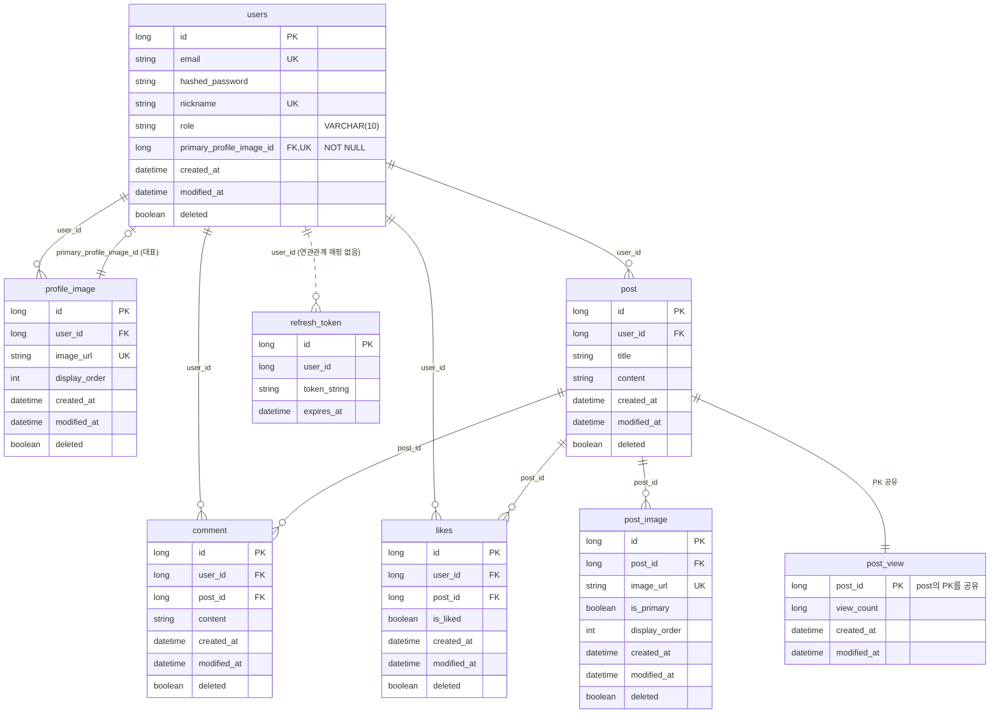

# ERD

JPA 엔티티(`ktb3.fullstack.week4.domain`) 매핑을 기준으로 정리한 테이블 구조다.
레포에 DDL 파일이 없고 `spring.jpa.hibernate.ddl-auto`가 `validate`라서, 이 문서는 엔티티에서 읽을 수 있는 내용만 담는다.
테이블 이름은 `@Table`로 지정한 `users`, `likes`를 제외하면 엔티티 클래스명을 Spring Boot 기본 네이밍 전략(snake_case)으로 변환한 이름이다.

## 1. 엔티티 → 테이블

| 엔티티 | 테이블 | 부모 클래스 | 비고 |
|---|---|---|---|
| `User` | `users` | `SoftDeletetionEntity` | |
| `ProfileImage` | `profile_image` | `Image` → `SoftDeletetionEntity` | |
| `Post` | `post` | `SoftDeletetionEntity` | |
| `PostImage` | `post_image` | `Image` → `SoftDeletetionEntity` | |
| `PostView` | `post_view` | `BaseTimeEntity` | `Post`와 기본키 공유(`@MapsId`) |
| `Comment` | `comment` | `SoftDeletetionEntity` | |
| `Like` | `likes` | `SoftDeletetionEntity` | |
| `RefreshToken` | `refresh_token` | 없음 | 시간·삭제 컬럼 없음 |

공통 부모 클래스는 다음 컬럼을 제공한다.

| 부모 클래스 | 컬럼 |
|---|---|
| `BaseTimeEntity` | `created_at`, `modified_at` — 둘 다 `DATETIME(6)`, NOT NULL (`@CreatedDate`, `@LastModifiedDate`) |
| `SoftDeletetionEntity` (`BaseTimeEntity` 상속) | `deleted` (boolean, 기본값 `false`) |
| `Image` (`SoftDeletetionEntity` 상속) | `image_url`, `display_order` (`is_primary`는 `PostImage`에만 있다) |

## 2. 관계도

- 다이어그램의 타입은 엔티티 필드의 Java 타입을 단순화한 것이다. 길이는 엔티티에 명시된 `users.role`(`VARCHAR(10)`)과 시간 컬럼(`DATETIME(6)`)만 적었다.
- 기본키는 `PostView`를 제외한 모든 엔티티가 `@GeneratedValue(strategy = GenerationType.IDENTITY)`(MySQL `AUTO_INCREMENT`)다. `PostView`는 `@MapsId`로 `Post`의 기본키를 그대로 쓴다.
- `post_view`의 기본키 컬럼 이름은 엔티티 매핑만으로는 확정하지 않았다. 다이어그램의 `post_id`는 연결 대상을 나타낸다.
- 연관관계는 모두 `@ManyToOne(fetch = LAZY)`이고 `@JoinColumn`으로 `user_id`·`post_id`를 지정한다. `Post#postView`는 `@OneToOne(mappedBy = "post", fetch = LAZY)`다.
- `User#primaryProfileImage`는 `@OneToOne(fetch = LAZY)` + `@JoinColumn(name = "primary_profile_image_id", nullable = false)`로 회원의 대표 프로필 이미지를 가리킨다. NOT NULL·UNIQUE·FK라 회원마다 대표가 정확히 1장이다. `updatable = false`라 엔티티 수정으로는 바뀌지 않고, 교체는 `UserRepository#updatePrimaryProfileImage`(포인터 컬럼만 UPDATE)로 한다.
- `RefreshToken#userId`는 `Long` 컬럼이고 `User`와의 연관관계 매핑이 없다.

## 3. UNIQUE 제약

엔티티에 선언된 `unique = true`는 다음과 같다.

| 테이블 | 컬럼 | 선언 위치 |
|---|---|---|
| `users` | `email` | `User#email` |
| `users` | `nickname` | `User#nickname` |
| `profile_image`, `post_image` | `image_url` | `Image#imageUrl` |
| `users` | `primary_profile_image_id` | 스키마(`schema.sql`)에만 선언. 엔티티는 `@OneToOne` |

## 4. soft delete

- `SoftDeletetionEntity#deleteEntity`가 `deleted`를 `true`로 바꾼다. 행은 지우지 않는다.
- 다음 엔티티에 `@SQLRestriction("deleted = false")`가 걸려 있어 엔티티 조회 SQL에 `deleted = false` 조건이 붙는다: `User`, `ProfileImage`, `PostImage`, `Post`, `Comment`, `Like`.
- 컬렉션 필드에도 같은 조건이 걸려 있다: `User#profileImages`, `Post#comments`, `Post#likes`, `Post#postImages`.
- `PostView`와 `RefreshToken`은 `deleted` 컬럼이 없다.
- 회원 탈퇴의 soft delete는 `UserDeleteFacade#deleteUser`가 한 트랜잭션에서 처리한다([architecture.md](architecture.md) 5장).

## 5. 저장소의 ERD 이미지와 다른 점

루트의 `ERD_그나저나_robin.png`와 현재 엔티티 매핑의 차이다.

| 항목 | 이미지 | 엔티티 매핑 |
|---|---|---|
| 회원 테이블 이름 | `user` | `users` (`@Table(name = "users")`) |
| 좋아요 테이블 이름 | `like` | `likes` (`@Table(name = "likes")`) |
| 기본키 컬럼 | `userId`, `postId` 등 엔티티별 이름 | 모두 `id` (`PostView`는 `Post`와 기본키 공유) |
| 수정일시 컬럼 | `comment.updatedAt` 등 `updatedAt`, `modifiedAt` 혼용 | 전부 `modified_at` (`BaseTimeEntity`) |
| 삭제 여부 컬럼 | `post.isDeleted` 등 `deleted`, `isDeleted` 혼용 | 전부 `deleted` (`SoftDeletetionEntity`) |
| `refresh_token` 테이블 | 없음 | `RefreshToken` 엔티티 |
| UNIQUE | 표시 없음 | `users.email`, `users.nickname`, `users.primary_profile_image_id`, `*_image.image_url` |
| 대표 프로필 이미지 | `profile_image.isPrimary` | `users.primary_profile_image_id`가 가리킴. `profile_image.is_primary` 없음 |
| 컬럼 길이·타입 | `VARCHAR(100)`, `VARCHAR(26)` 등 표기 | 엔티티는 `role`과 시간 컬럼 외에 길이를 지정하지 않음 |
