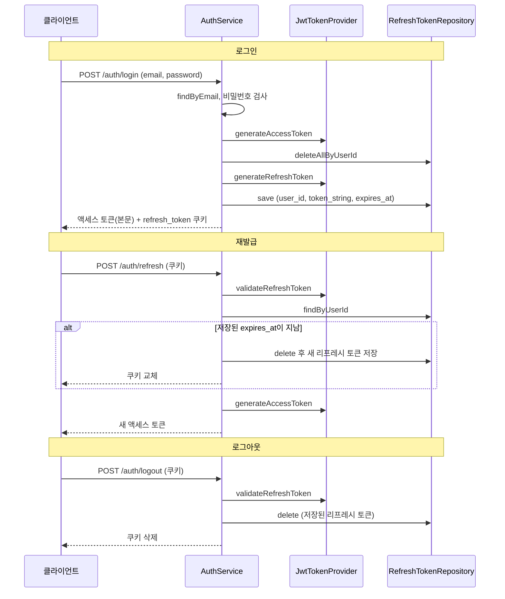

# 인증 (auth)

로그인, 액세스 토큰 재발급, 로그아웃과 토큰 구조를 정리한다.
공통 응답 형식과 보안 필터 체인은 [architecture.md](../../architecture.md)를 본다.

## 1. 배경

- 인증은 JWT 두 종류로 이루어진다. 액세스 토큰은 `Authorization: Bearer` 헤더로, 리프레시 토큰은 `refresh_token` 쿠키로 주고받는다.
- 서버는 세션을 쓰지 않는다(`SessionCreationPolicy.STATELESS`).
- 리프레시 토큰은 DB(`refresh_token` 테이블)에도 저장한다.

| 토큰 | 유효 시간 | 서명 키 설정 | 전달 방식 |
|---|---|---|---|
| 액세스 | 1시간 (`JwtTokenProvider#ACCESS_EXPIRE_SECONDS`) | `jwt.access-secret` | `Authorization: Bearer <token>` |
| 리프레시 | 7일 (`JwtTokenProvider#REFRESH_EXPIRE_SECONDS`) | `jwt.refresh-secret` | `refresh_token` 쿠키 (`HttpOnly`, `Path=/`) |

두 토큰 모두 `subject`에 회원 id를 담고 HS256으로 서명한다.

## 2. 목표가 아닌 것

- 회원가입·회원 정보 변경은 [user.md](user.md)에서 다룬다.
- 로그인 방식은 이메일·비밀번호 한 가지다.
- 서버가 DB에 저장하는 토큰은 리프레시 토큰뿐이다.

## 3. 스키마

`refresh_token` ([erd.md](../../erd.md) 참고)

| 컬럼 | 설명 |
|---|---|
| `id` | 기본키 |
| `user_id` | 회원 id (`User`와 연관관계 매핑 없음) |
| `token_string` | 리프레시 토큰 문자열 |
| `expires_at` | 저장 시점 기준 만료 시각 (`now + REFRESH_EXPIRE_SECONDS`) |

## 4. API 명세

### 4.1 로그인 `POST /auth/login`

- 권한: 공개 (`permitAll`, JWT 필터 제외)
- 요청 (JSON, `LoginRequest`): `email`(`@Email`, `@NotBlank`), `password`(`@NotBlank`)
- 처리 로직 (`AuthService#login`)
  1. `email` 또는 `password`가 null이면 `GenericError.INVALID_REQUEST`
  2. `userRepository.findByEmail`로 조회. 없으면 `AuthError.INVALID_EMAIL_OR_PASSWORD`
  3. `AppPasswordEncoder#matches`로 비밀번호 검사. 불일치면 `AuthError.INVALID_EMAIL_OR_PASSWORD`
  4. 액세스 토큰 발급, 해당 회원의 기존 리프레시 토큰 삭제(`deleteAllByUserId`), 리프레시 토큰 발급·저장
  5. 리프레시 토큰을 쿠키로 설정 (`CookieUtil#addHttpOnlyCookie`)
  6. 대표 프로필 이미지 URL 조회
- 응답: `message = login_success`, `data` = `LoginResponse`

| 필드 | 설명 |
|---|---|
| `profile_image_url` | 대표 프로필 이미지 URL |
| `access_token` | 액세스 토큰 |
| `token_type` | `Bearer` |
| `access_expired_in` | 액세스 토큰 유효 시간(초) |
| `refresh_expired_in` | 리프레시 토큰 유효 시간(초) |

- 오류: 400 `invalid_request`, 401 `invalid_email_or_password`

### 4.2 액세스 토큰 재발급 `POST /auth/refresh`

- 권한: `SecurityConfig`의 `permitAll` 목록에 없으므로 `anyRequest().hasRole("USER")`가 적용된다
- 요청: 본문 없음. `refresh_token` 쿠키
- 처리 로직 (`AuthService#refresh`)
  1. 쿠키가 없으면 `GenericError.INVALID_REQUEST`
  2. 리프레시 서명 키로 검증(`validateRefreshToken`). 실패하면 `AuthError.REFRESH_TOKEN_VALIDATION_FAIL`
  3. 토큰의 `subject`에서 회원 id를 읽는다. 없으면 `AuthError.REFRESH_TOKEN_EXPIRED`
  4. `refreshTokenRepository.findByUserId`로 저장된 토큰 조회
  5. 저장된 `expires_at`이 현재보다 이전이면 저장된 토큰을 삭제하고 새 리프레시 토큰을 발급·저장하며 쿠키를 교체한다
  6. 새 액세스 토큰 발급
- 응답: `message = access_token_refreshed`, `data` = `RefreshResponse` (`access_token`, `token_type`, `access_expired_in`)
- 오류: 400 `invalid_request`, 401 `refresh_token_validation_fail`, 401 `refresh_token_expired`

### 4.3 로그아웃 `POST /auth/logout`

- 권한: 4.2와 같다 (`anyRequest().hasRole("USER")`)
- 요청: 본문 없음. `refresh_token` 쿠키
- 처리 로직 (`AuthService#logout`)
  1. 쿠키가 없으면 `GenericError.INVALID_REQUEST`
  2. 리프레시 검증 실패 시 쿠키를 삭제하고 `AuthError.REFRESH_TOKEN_EXPIRED`
  3. 토큰의 `subject`에서 회원 id를 읽고, 저장된 리프레시 토큰을 삭제
  4. 쿠키 삭제 (`CookieUtil#deleteCookie`)
- 응답: `message = logout_success`
- 오류: 400 `invalid_request`, 401 `refresh_token_expired`

### 4.4 인증이 필요한 요청의 검증

`JwtAuthenticationFilter`가 처리한다. 순서와 분기는 [architecture.md](../../architecture.md) 3장의 시퀀스 다이어그램을 본다.

## 5. 흐름

## 6. 용어

| 용어 | 설명 |
|---|---|
| 액세스 토큰 | API 호출에 쓰는 단기 JWT. `Authorization` 헤더로 전달 |
| 리프레시 토큰 | 액세스 토큰 재발급에 쓰는 장기 JWT. `HttpOnly` 쿠키와 `refresh_token` 테이블에 저장 |
| `SecurityUser` | 인증된 사용자를 나타내는 `UserDetails` 구현. 컨트롤러가 `@AuthenticationPrincipal`로 받는다 |
