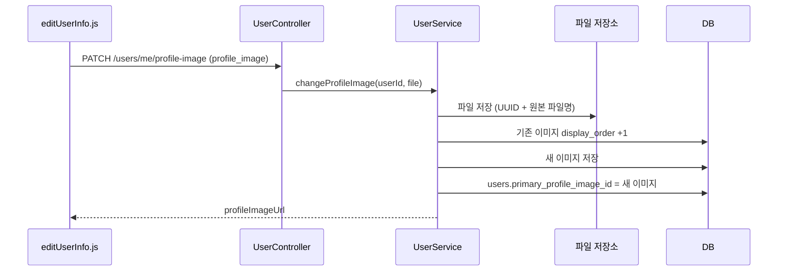

# 이미지 (image)

프로필 이미지와 게시글 이미지의 저장 방식, 대표 이미지, 프로필 이미지 교체 흐름을 정리한다.

## 1. 배경

- 프로필 이미지(`profile_image`)와 게시글 이미지(`post_image`)는 공통 부모 `Image`를 상속한다(`image_url`, `display_order`). `is_primary`는 `PostImage`에만 있다.
- 파일은 로컬 디렉터리에 저장하고 DB에는 URL 경로를 저장한다.
  - 저장 경로: `file.profileDir` 또는 `file.postDir` + `UUID` + 원본 파일명 (`ProfileImageService#makeImagePathString`, `PostImageService#makeImagePathString`)
  - DB에는 경로 중 `static` 이후 부분을 저장한다 (`UserService`, `PostService`의 `split("static")[1]`)
  - 저장 위치는 정적 리소스 경로 아래라서 `/assets/**`로 제공된다 ([architecture.md](../../architecture.md))
- 새로 만든 이미지는 `display_order = 1`이다(`ImageDomainBuilder#buildProfileImage`, `#buildPostImage`). 게시글 이미지는 `is_primary = true`로 만들고, 프로필 이미지는 회원의 포인터가 가리켜야 대표가 된다(5.1).

## 2. 목표가 아닌 것

- 회원가입·게시글 등록/수정의 전체 흐름은 [user.md](user.md), [post.md](post.md)에서 다룬다.
- 파일 저장소는 로컬 디렉터리 하나다. 외부 스토리지 연동은 없다.

## 3. 스키마

`profile_image`, `post_image` ([erd.md](../../erd.md) 참고)

| 컬럼 | 설명 | 제약 |
|---|---|---|
| `id` | 기본키 | |
| `user_id` / `post_id` | 소유 회원 / 게시글 | |
| `image_url` | URL 경로 | UNIQUE |
| `is_primary` | 대표 이미지 여부 (`post_image`만) | |
| `display_order` | 표시 순서 | |
| `created_at`, `modified_at`, `deleted` | 공통 컬럼 | |

대표 프로필 이미지는 `profile_image`의 컬럼이 아니라 `users.primary_profile_image_id`(NOT NULL·UNIQUE·FK)가 가리킨다.

## 4. 업로드 검사

| 항목 | 내용 | 위치 |
|---|---|---|
| 크기 | 파일당 10MB (`spring.servlet.multipart.max-file-size`) | `application.yml` |
| 크기·형식 | 10MB 초과 `image_size_too_big`, 컨텐츠 타입 없음 `file_type_omitted`, `image/jpeg`·`image/png` 외 `invalid_file_type`, 이미지 없음 `image_not_found` | `AvailabilityServiceImpl#checkImageAvailability` |

`checkImageAvailability`는 회원가입(`AvailabilityService#checkRegisterAvailability`) 경로에서 호출된다.

## 5. API 명세

공통: 인증이 필요하다(`anyRequest().hasRole("USER")`). 응답 본문은 `ApiResponse`.

### 5.1 프로필 이미지 등록·교체 `PATCH /users/me/profile-image`

- 요청: `multipart/form-data` — `profile_image`
- 처리 로직 (`UserService#changeProfileImage`)
  1. 회원 조회
  2. 파일 저장, 새 `ProfileImage`(`display_order = 1`) 생성
  3. 회원의 기존 프로필 이미지(`findAllByUserId`)마다 `display_order`를 1 올린다
  4. 새 이미지를 회원에 연결(`ProfileImage#linkUser`)하고 저장
  5. 회원의 대표를 새 이미지로 바꾼다(`UserRepository#updatePrimaryProfileImage`, 포인터 컬럼만 UPDATE). 포인터는 `updatable = false`라 닉네임 변경 등 다른 회원 수정이 되돌리지 않는다
- 응답: `message = profile_image_upload_success`, `data` = `ProfileImageUrlResponse` (`profileImageUrl`)
- 오류: 404 `cannot_found_user`

### 5.2 게시글 이미지

게시글 이미지는 별도 엔드포인트 없이 게시글 API에서 다룬다.

| 동작 | 처리 |
|---|---|
| 등록 (`PostService#uploadPost`) | `image`가 있으면 저장하고 대표 이미지로 생성 |
| 수정 (`PostService#editPost`) | `image`가 비어 있지 않으면 기존 대표 이미지를 soft delete하고 새 이미지를 대표로 저장 |
| 상세 (`PostService#getSinglePostDeatil`) | 대표 이미지 URL과 나머지 이미지 URL(`display_order` 오름차순) 반환 |
| 삭제 (`PostDeleteFacade#deletePost`) | 게시글 이미지를 soft delete |

## 6. 흐름: 프로필 이미지 교체

FE(`editUserInfo.js`)는 파일을 선택하면 `PATCH` 한 번만 호출한다. 기존 대표 해제와 새 대표 지정이 한 트랜잭션 안에서 끝나므로 대표가 없는 중간 상태가 없다.

## 7. 용어

| 용어 | 설명 |
|---|---|
| 대표 이미지 | 프로필: `users.primary_profile_image_id`가 가리키는 이미지. 로그인 응답·게시글 목록·상세·댓글 목록의 작성자 프로필 이미지로 쓰인다. 게시글: `is_primary = true`인 이미지 |
| `display_order` | 이미지 표시 순서. 새 이미지는 1이고 기존 이미지는 교체 시 1씩 올라간다 |
| soft delete | 행을 지우지 않고 `deleted = true`로 표시 |
