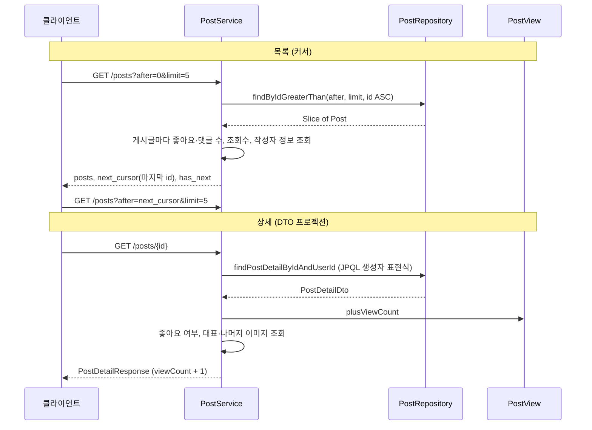

# 게시글 (post)

게시글 등록·목록·상세·수정·삭제를 정리한다. 댓글은 [comment.md](comment.md), 좋아요는 [like.md](like.md), 이미지는 [image.md](image.md)에서 다룬다.

## 1. 배경

- 게시글은 제목, 본문, 작성자를 가진다. 조회수는 별도 테이블(`post_view`)에 둔다.
- 게시글 한 건은 이미지를 0~여러 장 가질 수 있다(`post_image`).
- 목록은 커서 방식이다. `Slice`를 쓰고 마지막으로 본 게시글 id(`after`)를 커서로 쓴다.
- 상세 조회는 JPQL 생성자 표현식으로 `PostDetailDto`에 필요한 값을 한 번에 조회한다.

## 2. 목표가 아닌 것

- 댓글 목록은 `GET /posts/{postId}/comments`로 제공하며 [comment.md](comment.md)에서 다룬다.
- 목록 응답은 제목과 집계 값만 담고 본문(`content`)은 담지 않는다. 본문은 상세 조회에서 반환한다.

## 3. 스키마

`post`, `post_view`, `post_image` ([erd.md](../../erd.md) 참고)

| 테이블 | 컬럼 | 설명 |
|---|---|---|
| `post` | `id`, `user_id`, `title`, `content` + 공통 컬럼 | 게시글 |
| `post_view` | `post_id`(기본키, `post`와 공유), `view_count` | 조회수 (`deleted` 없음) |
| `post_image` | `id`, `post_id`, `image_url`, `is_primary`, `display_order` + 공통 컬럼 | 게시글 이미지 |

## 4. API 명세

공통: 모든 `/posts/**` 요청은 인증이 필요하다(`anyRequest().hasRole("USER")`). 응답 본문은 `ApiResponse`.

### 4.1 등록 `POST /posts`

- 요청: `multipart/form-data`
  - `dto` (JSON, `PostUploadRequeset`): `title`(`@NotBlank`), `content`(`@NotBlank`)
  - `image`: 선택
- 처리 로직 (`PostService#uploadPost`)
  1. 회원 조회
  2. `PostDomainBuilder#buildPost`로 게시글, `#buildPostView`로 조회수(0) 생성·저장
  3. `image`가 있으면 파일 저장 후 `ImageDomainBuilder#buildPostImage`로 대표 이미지 생성·저장
- 응답: `message = post_upload_success`
- 오류: 400 `invalid_request`, 404 `cannot_found_user`

### 4.2 목록 `GET /posts?after=&limit=`

- 요청: `after`(int, 마지막으로 받은 게시글 id. 처음은 0), `limit`(int)
- 처리 로직 (`PostService#getPostList`)
  1. 회원 조회
  2. `PostRepository#findByIdGreaterThan(after, PageRequest.of(0, limit, Sort.by(ASC, "id")))`로 `Slice<Post>` 조회
  3. 게시글마다 좋아요 수(`LikeRepository#countByPostId`, `isLiked = true`만 집계), 댓글 수(`CommentRepository#countByPostId`), 조회수(`PostView#getViewCount`), 작성자 닉네임, 작성자 대표 프로필 이미지 URL을 조회해 `PostBriefInfo` 구성
  4. `next_cursor` = 응답의 마지막 게시글 id (비어 있으면 요청의 `after`), `has_next` = `Slice#hasNext`
- 응답: `message = posts_fetch_success`, `data` = `PostListResponse`

| 필드 | 설명 |
|---|---|
| `posts[]` | `id`, `title`, `likeCount`, `commentCount`, `viewCount`, `author`, `authorProfileImageUrl`, `modified_at` |
| `next_cursor` | 다음 요청의 `after` 값 |
| `has_next` | 다음 페이지 존재 여부 |

- 오류: 404 `cannot_found_user`

### 4.3 상세 `GET /posts/{id}`

- 처리 로직 (`PostService#getSinglePostDeatil`)
  1. 회원 조회. `postId <= 0`이면 `GenericError.INVALID_REQUEST`
  2. `PostRepository#findPostDetailByIdAndUserId`로 `PostDetailDto` 조회. 없으면 `PostError.CANNOT_FOUND_POST`
  3. `PostView#plusViewCount`로 조회수 증가. 응답의 `viewCount`는 조회한 값 + 1
  4. 현재 회원의 좋아요 여부 조회 (`existsByPostIdAndUserIdAndIsLikedTrue`)
  5. 대표 이미지 URL 조회. 없으면(이미지 없이 쓴 글) `primary_image_url = null`. 나머지 이미지는 `displayOrder` 오름차순
  6. `isOwner` = 작성자 id와 현재 회원 id 비교
- 응답: `message = post_fetch_success`, `data` = `PostDetailResponse`

| 필드 | 설명 |
|---|---|
| `post` | `id`, `title`, `likeCount`, `commentCount`, `viewCount`, `author`, `authorProfileImageUrl`, `modified_at`, `primary_image_url`, `rest_image_urls`, `content` |
| `isLiked`, `isOwner` | 현재 회원의 좋아요 여부, 작성자 여부 (Java 필드명. JSON 키는 Lombok getter 규칙을 따르며 FE는 `liked`, `owner`로 읽는다) |

- 오류: 400 `invalid_request`, 404 `cannot_found_user`, 404 `cannot_found_post`

`PostDetailDto` 조회 쿼리 (`PostRepository#findPostDetailByIdAndUserId`)

| 값 | 조회 방식 |
|---|---|
| 게시글 id·제목·본문·수정일시 | `Post p` |
| 작성자 id·닉네임 | `JOIN p.user u` |
| 작성자 대표 프로필 이미지 | `LEFT JOIN u.primaryProfileImage pi` |
| 조회수 | `LEFT JOIN p.postView pv` |
| 좋아요 수 | 서브쿼리 `COUNT(Like) WHERE isLiked = true` |
| 댓글 수 | 서브쿼리 `COUNT(Comment)` |
| 현재 회원의 좋아요 여부 | 서브쿼리 `COUNT(Like) WHERE user.id = :userId AND isLiked = true` > 0 |

### 4.4 수정 `PATCH /posts/{id}`

- 요청: `multipart/form-data` — `dto`(JSON, `PostEditRequest`: `title`, `content` 모두 `@NotBlank`), `image`(선택)
- 처리 로직 (`PostService#editPost`)
  1. 회원·게시글 조회. 작성자가 아니면 `PostError.CANNOT_EDIT_OTHERS_POST`
  2. `Post#editPost`로 제목·본문 변경
  3. `image`가 비어 있지 않으면 기존 대표 이미지를 soft delete하고 새 이미지를 대표로 저장, 게시글의 `modified_at`을 새 이미지의 `modified_at`으로 갱신
- 응답: `message = post_edit_success`
- 오류: 400 `invalid_request`, 404 `cannot_found_user`, 404 `cannot_found_post`, 403 `cannot_edit_others_post`

### 4.5 삭제 `DELETE /posts/{id}`

- 처리 로직 (`PostService#removePost`): 회원·게시글 조회 → 작성자가 아니면 `PostError.CANNOT_DELETE_OTHERS_POST` → `PostDeleteFacade#deletePost`
- `PostDeleteFacade#deletePost`(`Propagation.MANDATORY`)는 게시글 이미지, 댓글, 좋아요, 게시글 순으로 `deleted`가 아닌 것을 soft delete한다. `PostView`는 남긴다.
- 응답: `message = post_remove_success`
- 오류: 404 `cannot_found_user`, 404 `cannot_found_post`, 403 `cannot_delete_others_post`

## 5. 흐름

## 6. 용어

| 용어 | 설명 |
|---|---|
| 커서 | 다음 페이지의 시작 위치를 나타내는 값. 게시글 목록은 마지막 게시글 id(`after`) |
| `Slice` | 전체 건수를 세지 않고 다음 페이지 존재 여부(`hasNext`)만 아는 페이지 결과 |
| 대표 이미지 | `is_primary = true`인 이미지. 게시글 이미지는 등록 시 `displayOrder = 1`, 대표로 저장된다 |
| DTO 프로젝션 | 엔티티 대신 필요한 값만 JPQL로 조회해 DTO로 받는 방식 (`PostDetailDto`) |
