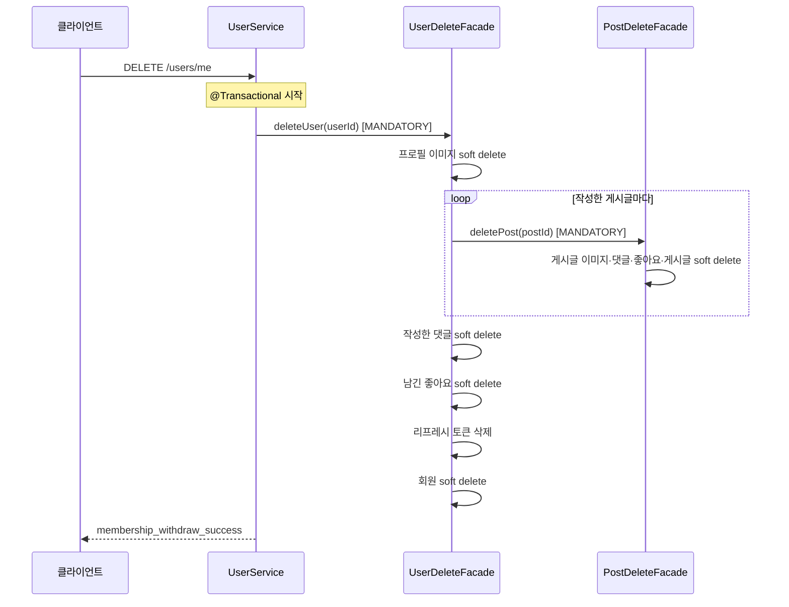

# 회원 (user)

회원가입, 가용성 검사, 회원 정보 조회·수정, 회원 탈퇴를 정리한다.
프로필 이미지는 [image.md](image.md)에서 다룬다.

## 1. 배경

- 회원은 이메일, 해시된 비밀번호, 닉네임, 권한(`role`)을 가진다.
- 비밀번호는 `AppPasswordEncoder`로 인코딩해 저장한다. `AppPasswordEncoder`는 `PasswordEncoder` 빈(`SecurityConfig#passwordEncoder`, `BCryptPasswordEncoder`)에 위임한다.
- 가입 시 `role`은 `Role.ROLE_USER`로 저장한다(`UserDomainBuilder#buildUser`).
- 회원 삭제는 soft delete이며, 연관 데이터까지 `UserDeleteFacade`가 한 트랜잭션에서 처리한다.

## 2. 목표가 아닌 것

- 로그인·토큰은 [auth.md](auth.md)에서 다룬다.
- 회원 정보 조회 API(`GET /users/me`)는 이메일과 닉네임만 반환하고 프로필 이미지는 포함하지 않는다.

## 3. 스키마

`users` ([erd.md](../../erd.md) 참고)

| 컬럼 | 설명 | 제약 |
|---|---|---|
| `id` | 기본키 | |
| `email` | 이메일 | UNIQUE |
| `hashed_password` | 해시된 비밀번호 | |
| `nickname` | 닉네임 | UNIQUE |
| `role` | 권한 (`VARCHAR(10)`) | `ROLE_USER` / `ROLE_ADMIN` (`Role`) |
| `created_at`, `modified_at`, `deleted` | 공통 컬럼 | |

## 4. API 명세

공통: 응답 본문은 `ApiResponse`(`message`, `data`). "인증 필요"는 `anyRequest().hasRole("USER")`를 뜻한다.

### 4.1 회원가입 `POST /users`

- 권한: 공개
- 요청: `multipart/form-data`
  - `dto` (JSON, `JoinRequest`): `email`(`@Email`, `@NotBlank`), `password`(`@NotBlank`), `nickname`(`@NotBlank`)
  - `image`: 프로필 이미지 파일
- 처리 로직 (`UserService#register`)
  1. `AvailabilityService#checkRegisterAvailability` — 이메일 중복, 닉네임 중복, 이미지 검사 순서
  2. 비밀번호 인코딩, `UserDomainBuilder#buildUser`로 회원 생성
  3. 이미지 저장, `ImageDomainBuilder#buildProfileImage`로 대표 이미지 생성
  4. 프로필 이미지·회원 저장
- 응답: `message = register_success`
- 오류: 400 `invalid_request`(`@Valid` 실패), 409 `existing_email`, 409 `existing_nickname`, 404 `image_not_found`(이미지 없음), 400 `image_size_too_big`, 400 `file_type_omitted`, 400 `invalid_file_type`

### 4.2 가용성 검사 `GET /availability/email?value=`, `GET /availability/nickname?value=`

- 권한: 공개
- 처리 로직: `existsByEmail` / `existsByNickname`이 참이면 각각 `UserError.EXISTING_EMAIL` / `EXISTING_NICKNAME`
- 응답: `message = valid_email` / `valid_nickname`
- 오류: 409 `existing_email`, 409 `existing_nickname`

### 4.3 내 정보 조회 `GET /users/me`

- 권한: 인증 필요
- 처리 로직 (`UserService#getUserInfoForEditPage`): 회원 조회 후 이메일·닉네임 반환
- 응답: `message = userinfo_fetch_success`, `data` = `UserEditPageResponse` (`email`, `nickname`)
- 오류: 404 `cannot_found_user`

### 4.4 닉네임 변경 `PATCH /users/me/nickname`

- 권한: 인증 필요
- 요청 (JSON, `NicknameUpdateRequest`): `newNickname`(`@NotBlank`)
- 처리 로직 (`UserService#changeNickname`): 회원 조회 → `checkNewNicknameAvailability` → `User#changeNickName`
- 응답: `message = nickname_edit_success`, `data` = `NicknameUpdateResponse` (`newNickname`)
- 오류: 400 `invalid_request`, 404 `cannot_found_user`, 409 `existing_nickname`

### 4.5 비밀번호 변경 `PATCH /users/me/password`

- 권한: 인증 필요
- 요청 (JSON, `PasswordUpdateRequest`): `newPassword` — 8~20자, 소문자·대문자·`!@#$%^&*` 중 특수문자를 각각 1개 이상 포함하고 영문자·숫자·해당 특수문자로만 구성 (`@Pattern`)
- 처리 로직 (`UserService#changePassword`): 회원 조회 → 인코딩 → `User#changePassword`
- 응답: `message = password_edit_success`
- 오류: 400 `invalid_request`, 404 `cannot_found_user`

### 4.6 회원 탈퇴 `DELETE /users/me`

- 권한: 인증 필요
- 처리 로직: `UserService#withdrawMemberShip`이 `@Transactional`로 `UserDeleteFacade#deleteUser`를 호출한다. Facade는 `Propagation.MANDATORY`다.
- 응답: `message = membership_withdraw_success`
- 오류: 404 `cannot_found_user`

`UserDeleteFacade#deleteUser`의 처리 순서

| 순서 | 대상 | 처리 |
|---|---|---|
| 1 | 프로필 이미지 | `deleted`가 아닌 것을 soft delete |
| 2 | 작성한 게시글 | 게시글마다 `PostDeleteFacade#deletePost` (게시글 이미지·댓글·좋아요·게시글 soft delete) |
| 3 | 작성한 댓글 | `deleted`가 아닌 것을 soft delete |
| 4 | 남긴 좋아요 | `deleted`가 아닌 것을 soft delete |
| 5 | 리프레시 토큰 | `refreshTokenRepository.deleteByUserId` (물리 삭제) |
| 6 | 회원 | `User#deleteEntity` |

`PostView`(조회수)는 삭제하지 않고 남긴다.

## 5. 용어

| 용어 | 설명 |
|---|---|
| soft delete | 행을 지우지 않고 `deleted = true`로 표시. 조회는 `@SQLRestriction("deleted = false")` |
| Facade | 여러 리포지토리에 걸친 삭제를 한 곳에서 처리하는 서비스 (`UserDeleteFacade`, `PostDeleteFacade`) |
| `Propagation.MANDATORY` | 상위 트랜잭션이 없으면 실행되지 않는 전파 속성 |
